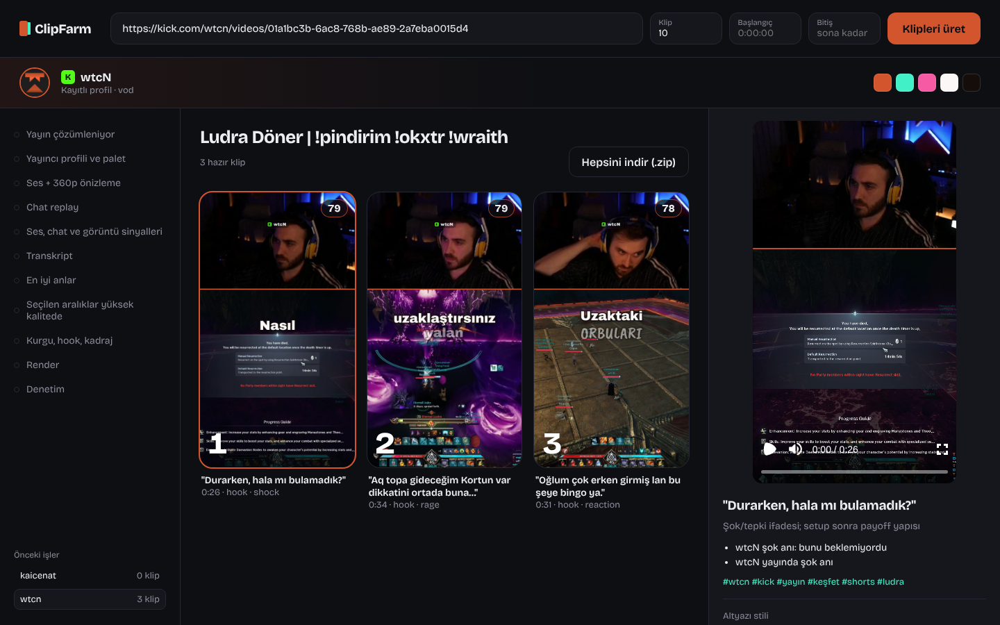
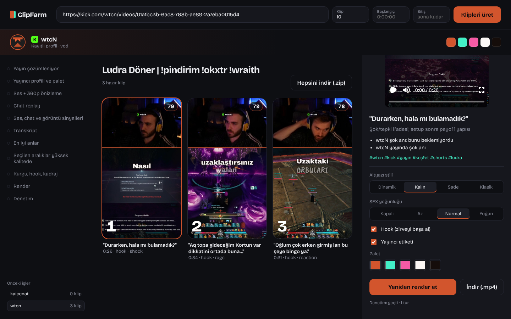

# ClipFarm

Paste a Kick or Twitch link and get publish-ready 1080x1920 vertical clips. Each clip comes with:
- a cover frame;
- 3 title suggestions, a description and hashtags;
- a 0–100 score with the reason the moment works.

```
link ─► stage 1: audio + 360p preview + chat ─► signals (audio / chat / video) ─► transcript (word-level)
     ─► best moments (LLM or heuristic) ─► stage 2: only those ranges in 1080p60 (+5 s padding)
     ─► edit (cold-open hook, dead-air trim, punch-ins) ─► 9:16 layout (facecam + game / face tracking)
     ─► Remotion render (multi-font captions) + ffmpeg audio (SFX, ducking, -14 LUFS) ─► self-QA ─► gallery
```

## Install (one command)

Requirements: Linux or macOS, Python ≥3.10, Node ≥18, ffmpeg. An NVIDIA GPU is optional.

```bash
cd clipfarm
./install.sh
```

The script:
- creates `.venv` and installs the package with nightly yt-dlp;
- installs the Node dependencies, builds the UI and downloads Remotion's headless Chrome;
- fetches the face-detection model and TwitchDownloaderCLI;
- builds the SFX library if it is missing;
- runs `clipfarm doctor`, which prints the detected hardware and backends.

Then put your gateway in `.env` (optional but recommended):

```
LLM_BASE_URL=https://your-gateway.example.com/v1
LLM_API_KEY=...
LLM_MODEL=claude-sonnet-5-5
```

Without an LLM, moment scoring, emphasis words and titles fall back to deterministic heuristics, and the vision QA step is skipped.

## Run

```bash
./bin/clipfarm serve                       # web app on http://127.0.0.1:8765
./bin/clipfarm <link> --clips 10           # CLI
./bin/clipfarm <link> --clips 5 --start 1:30:00 --end 2:30:00 --style bold --sfx 1
./bin/clipfarm rerender <job_id> c03 --settings '{"caption_style":"clean","hook":false}'
./bin/clipfarm doctor                      # hardware / tools / LLM status
```

Accepted links:
- VOD: `twitch.tv/videos/…`, `kick.com/<ch>/videos/<uuid>`
- Clip: `clips.twitch.tv/…`, `kick.com/<ch>/clips/…`
- Channel: `twitch.tv/<ch>`, `kick.com/<ch>`. If the channel is live, ClipFarm takes the part of the current stream recorded so far; otherwise it takes the latest VOD.

Outputs:
- `output/<channel>/<job>/NN_<title>_<clip>.mp4|.jpg|.json`
- full working data in `work/<job>/` (resumable: re-running the same link reuses everything already done)

## The web app

One screen, in this order:
1. Paste a link. The streamer is recognised immediately (avatar, platform and palette); first-time streamers get a profile automatically.
2. Live pipeline steps run on the left.
3. Clips appear in a gallery sorted by score.
4. Clicking a clip opens the real Remotion Player: the same composition that renders the export, so the preview is exact.
5. Per clip you can change caption style, palette, hook on/off, SFX density and the streamer label. Then "Yeniden render et" re-renders the clip, or download one clip or all of them as a zip.

The UI takes the streamer's accent colour.





## Example output

`docs/samples/` holds light 720p previews, covers, frame sheets and the QA numbers of the end-to-end test clips:
- 3 clips from a Kick VOD (wtcN, Turkish);
- 3 clips from a Twitch VOD (KaiCenat, English).

See `docs/samples/README.md`.

## Streamer profiles

`streamers/<slug>/profile.json` is created on first sight. Edit it by hand or via `PUT /api/profiles/<slug>`.

```jsonc
{
  "language": "auto",                    // or "tr", "en", ...
  "facecam": {"mode": "split", "box": [x, y, w, h], "locked": false},   // set locked: true after fixing by hand
  "palette": {"primary": "#…", "accent": "#…", "accent2": "#…", "text": "#…", "stroke": "#…", "locked": false},
  "dictionary": {"terms": ["Jahrein", "Ludra", "KEKW"], "replace": {"cahrayn": "Jahrein"}},
  "fonts": {"set": "default", "exclude": []},
  "captions": {"style": "dynamic"},
  "label": {"enabled": true},
  "hook": {"enabled": true},
  "sfx": {"density": 2},
  "campaign": {"max_duration": 59, "required_hashtags": ["#sponsor"], "required_mentions": [], "censor_profanity": false, "cta": ""}
}
```

`palette.png` is regenerated whenever the palette changes. The palette is built from the avatar, banner, offline screen and panels, using k-means, hue separation and a WCAG contrast check against the caption stroke.

## Configuration (`.env`)

See `.env.example`. The most important settings:
- `DOWNLOAD_RATE_LIMIT` (e.g. `4M`) throttles every download.
- `PREVIEW_HEIGHT` (0 = audio-only stage 1).
- `COOKIES_FILE` for sub-only VODs.
- `WHISPER_MODEL` / `TRANSCRIBE_SCOPE`.
- `VIDEO_BITRATE`.

## Project layout

```
clipfarm/            python package (pipeline, download, chat, transcribe, signals, layout, moments, edit,
                     captions, audio, render, qa, meta, profile, server, cli)
studio/              Remotion composition (src/remotion) + web UI (src/ui) + render worker (render.mjs)
assets/fonts         7 Turkish-verified OFL fonts + fonts.json
assets/sfx           SFX library (10 categories, 5-7 variations) + manifest.json
assets/models        YuNet face detector
streamers/           per-streamer profiles, art, palette.png
scripts/             build_sfx.py, gen_licenses.py, caption_research.py
docs/                font tests, caption references, example frames
```

## Known limits

- **CPU-only machines:**
  - Whisper `small` runs at about 0.9× realtime on 4 cores, so only heat-ranked windows are transcribed. Moments with no audio, chat or visual spike can be missed; a GPU, or `TRANSCRIBE_SCOPE=full`, fixes that.
  - Turkish accuracy with `small` is good but not perfect, so the streamer dictionary matters.
  - Remotion rendering of 1080x1920 at 60 fps takes several minutes per clip on 4 cores.
- **Kick chat history is sparse.** The API returns only a fraction of messages, so chat counts for little on Kick and audio and video carry the score.
- **No LLM configured:** moment choice and titles are heuristic. They work, but the LLM path produces much better "why it works" notes, emphasis words and titles.
- **@nocodealex research:** Instagram requires a login and ClipFarm does not get around it. The analysis used his public TikTok cross-posts (January 2023); `scripts/caption_research.py` re-runs it on the latest Reels with your own cookies.
- **Facecam detection** assumes a rectangular overlay. Rounded or masked cams fall back to an expanded face box; fix it once in `profile.json` with `locked: true`.
- **Sub-only VODs** need `COOKIES_FILE`.
- **Live-in-progress Kick streams** only work once Kick has created the VOD entry, which normally happens shortly after going live.
- **Remotion** is free for individuals and companies of up to 3 people. Larger companies need a licence (`REMOTION_LICENSE_KEY`).
- **TwitchDownloaderCLI** is fetched from GitHub Releases by `install.sh`. It is only a last-resort fallback and could not be tested in the build environment.
