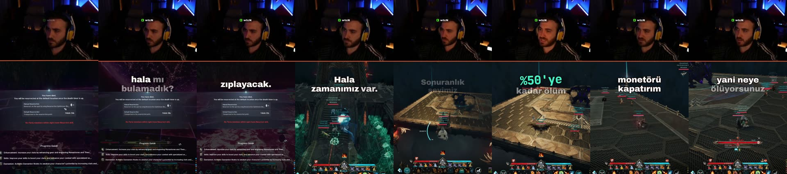
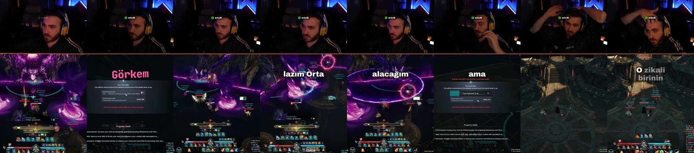
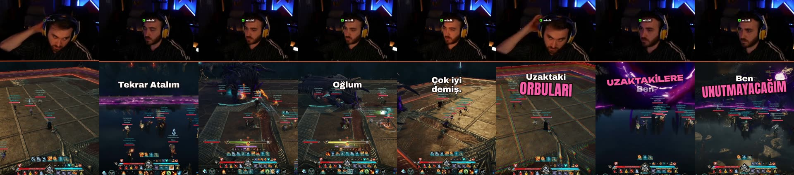
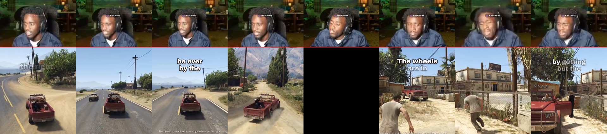
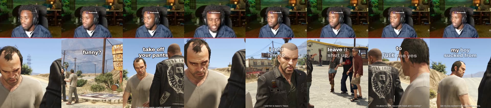
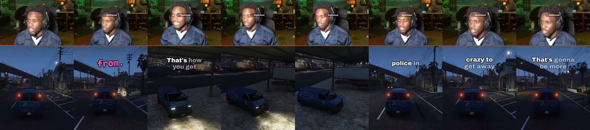

# Sample clips

Light previews (720x1280, about 2 Mbps) of real end-to-end runs. The full exports are 1080x1920 H.264 High at about 14 Mbps
and live in `output/` (not committed).

## Kick: wtcn (Ludra Döner | !pindirim !okxtr !wraith)

VOD `01a1bc3b-6ac8-768b-ae89-2a7eba0015d4`, analysed window 5400-9000 s.

### 1. "Nasıl kişi kaldık kanka?"  (score 79.4)

- Video: [kick_wtcn_01.mp4](kick_wtcn_01.mp4), cover: [kick_wtcn_01_cover.jpg](kick_wtcn_01_cover.jpg)
- Why: Şok/tepki ifadesi; setup sonra payoff yapısı
- Duration 26.0 s, hook (cold open): yes, category: shock
- Alternative titles: wtcN şok anı: bunu beklemiyordu / wtcN yayında şok anı
- Hashtags: #wtcn #kick #yayın #keşfet #shorts #ludra
- QA: passed in 1 round(s); loudness -13.7 LUFS, true peak -1.2 dBTP; caption sync median 17.0 ms over 28 words; black frames: 0; face overlaps: 0

### 2. "Yoo ya O zikali birinin kollaması lazım kanka"  (score 78.8)

- Video: [kick_wtcn_02.mp4](kick_wtcn_02.mp4), cover: [kick_wtcn_02_cover.jpg](kick_wtcn_02_cover.jpg)
- Why: Ses enerjisinde ani sıçrama (bağırma/tepki); setup sonra payoff yapısı
- Duration 34.32 s, hook (cold open): yes, category: rage
- Alternative titles: wtcN sinir krizi: bunu beklemiyordu / wtcN yayında sinir krizi
- Hashtags: #wtcn #kick #yayın #keşfet #shorts #ludra
- QA: passed in 1 round(s); loudness -14.0 LUFS, true peak -1.3 dBTP; caption sync median 38.5 ms over 16 words; black frames: 0; face overlaps: 0

### 3. "Dikkat edin Dikkat edin Dikkat"  (score 78.0)

- Video: [kick_wtcn_03.mp4](kick_wtcn_03.mp4), cover: [kick_wtcn_03_cover.jpg](kick_wtcn_03_cover.jpg)
- Why: Setup sonra payoff yapısı
- Duration 28.7 s, hook (cold open): yes, category: reaction
- Alternative titles: wtcN tepki: bunu beklemiyordu / wtcN yayında tepki
- Hashtags: #wtcn #kick #yayın #keşfet #shorts #ludra
- QA: passed in 1 round(s); loudness -14.1 LUFS, true peak -1.0 dBTP; caption sync median 17.0 ms over 22 words; black frames: 0; face overlaps: 0

## Twitch: kaicenat (🎮 PLAYING EVERY GTA UNTIL I BEAT IT: Grand Theft Auto 4🎮)

VOD `v2924282282`, analysed window 36000-39600 s.

### 1. "The wheels are in motion."  (score 79.0)

- Video: [twitch_kaicenat_01.mp4](twitch_kaicenat_01.mp4), cover: [twitch_kaicenat_01_cover.jpg](twitch_kaicenat_01_cover.jpg)
- Why: Chat velocity spiked (~10.1x); emote/laugh spam in chat; sudden audio energy jump (shout/reaction); shock/reaction line; setup then payoff structure
- Duration 19.37 s, hook (cold open): yes, category: funny
- Alternative titles: KaiCenat did NOT expect this / KaiCenat's funny moment on stream
- Hashtags: #kaicenat #twitch #stream #fyp #shorts #playing
- QA: passed in 1 round(s); loudness -14.0 LUFS, true peak -1.9 dBTP; caption sync median 20.0 ms over 41 words; black frames: 0; face overlaps: 0

### 2. "Is that the problem here?"  (score 77.8)

- Video: [twitch_kaicenat_02.mp4](twitch_kaicenat_02.mp4), cover: [twitch_kaicenat_02_cover.jpg](twitch_kaicenat_02_cover.jpg)
- Why: Chat velocity spiked (~7.0x); emote/laugh spam in chat; sudden audio energy jump (shout/reaction); setup then payoff structure
- Duration 26.5 s, hook (cold open): yes, category: funny
- Alternative titles: KaiCenat did NOT expect this / KaiCenat's funny moment on stream
- Hashtags: #kaicenat #twitch #stream #fyp #shorts #playing
- QA: passed in 1 round(s); loudness -13.9 LUFS, true peak -1.3 dBTP; caption sync median 30.0 ms over 69 words; black frames: 0; face overlaps: 0

### 3. "I think the police in 6th gon' be"  (score 76.6)

- Video: [twitch_kaicenat_03.mp4](twitch_kaicenat_03.mp4), cover: [twitch_kaicenat_03_cover.jpg](twitch_kaicenat_03_cover.jpg)
- Why: Chat velocity spiked (~6.9x); emote/laugh spam in chat; sudden audio energy jump (shout/reaction); shock/reaction line; setup then payoff structure
- Duration 14.83 s, hook (cold open): yes, category: shock
- Alternative titles: KaiCenat did NOT expect this / KaiCenat's shock moment on stream
- Hashtags: #kaicenat #twitch #stream #fyp #shorts #playing
- QA: passed in 1 round(s); loudness -13.7 LUFS, true peak -2.3 dBTP; caption sync median 10.0 ms over 32 words; black frames: 0; face overlaps: 0

